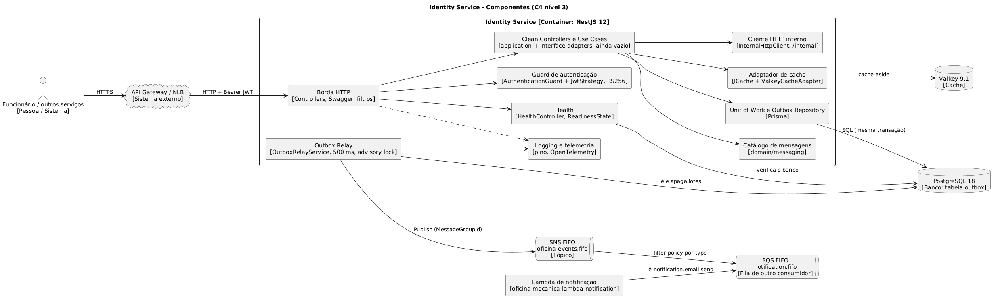

# Arquitetura

Visão do Identity Service como está no repositório. As decisões estão nas [ADRs](adr/).

## Índice

- [Camadas](#camadas)
- [Componentes copiados do template](#componentes-copiados-do-template)
- [Mensageria com outbox](#mensageria-com-outbox)
- [Cache do dono](#cache-do-dono)
- [Autenticação e Swagger](#autenticação-e-swagger)
- [Exceções por camada](#exceções-por-camada)
- [Modelo C4](#modelo-c4)

## Camadas

Clean Architecture com regra de dependência única: o código aponta só para dentro. A regra é imposta pelas regras `no-restricted-imports` de `app/eslint.config.mjs`, que falham o `npm run lint` quando uma camada interna importa framework, ORM, telemetria ou SDK externo.

| Camada | Pasta (`app/src/`) | Conteúdo hoje | Pode importar |
| --- | --- | --- | --- |
| Domínio | `domain/` | Catálogo tipado de mensagens (`messaging/`), exceções de domínio, portas de repositório (`IOutboxRepository`, `IUnitOfWork`), enum de papéis (`UserRole`) | Nada de `@nestjs/*`, Prisma (`@generated/*`), `@opentelemetry/*`, `@aws-sdk/*` nem `ioredis` |
| Aplicação | `application/` | Principal autenticado (`auth/`), portas de saída em `ports/output/services/` (`ICache`, `ILogger`, `IMetrics`), exceções, catálogos de log e de métricas | Idem |
| Adaptadores de interface | `interface-adapters/` | Clean Controllers e Presenters; a pasta ainda não existe, porque não há rota de negócio | Idem |
| Infraestrutura | `infrastructure/` | Borda HTTP do NestJS, Prisma, mensageria, cache, cliente HTTP interno, logging, telemetria, health | Tudo; só `infrastructure/persistence/prisma/` importa o Prisma |

Use cases e Clean Controllers são classes sem `@Injectable`: o módulo Nest os compõe com `useFactory` e o `@Controller` fino de `infrastructure/http/` só delega. Quando chegarem as rotas de negócio, elas seguem esse padrão. Porta de saída para outro serviço será um gateway em `application/ports/output/gateways/<dono>/`, com o adaptador em `infrastructure/gateways/<dono>/` sobre o `InternalHttpClient`.

## Componentes copiados do template

O esqueleto foi copiado do Inventory, que tem os mesmos componentes transversais do Work Order (o serviço que serve de template), sem domínio e sem o consumidor de fila:

- `infrastructure/config`: `configureApp` (prefixo global `api`, Helmet, CORS, `SanitizeStringsPipe`, `ValidationPipe` com `whitelist`, `forbidNonWhitelisted` e `transform`, Swagger) e `resolvePort`;
- `infrastructure/http`: filtros de exceção por camada, guard de autenticação deny-by-default (toda rota exige token, salvo as marcadas como públicas), estratégia JWT de funcionário, guard de papéis, interceptors e o middleware que devolve 404 JSON fora do prefixo;
- `infrastructure/logging` e `infrastructure/telemetry`: uma linha JSON por evento no stdout (a saída padrão do processo), pela porta `ILogger` e por catálogos tipados, e o SDK OpenTelemetry carregado só por preload (`node --require ./dist/src/otel.js dist/src/main`);
- `infrastructure/health`: vivacidade e prontidão, com encerramento gracioso;
- `infrastructure/messaging`, `infrastructure/cache` e `infrastructure/clients`: relay do outbox e cliente SNS, adaptador Valkey e cliente HTTP interno `InternalHttpClient` (rotas `/internal/...` ainda não existem neste serviço; quando entrarem, precisam de `@Public()` e `@ApiExcludeController()`, porque o guard global também as cobre, e rota com `@Roles` precisa de `@UseGuards(RolesGuard)`, que não é global).

O consumidor SQS dos outros serviços não foi copiado: o Identity só publica. Não há variável de nome de fila, nem dependência de consumo em produção; o `@aws-sdk/client-sqs` aparece só nas `devDependencies`, para o teste E2E do outbox ler a fila assinante e conferir o que foi publicado.

Migration roda só como passo separado (serviço `migrate` do Compose, Job do Kubernetes no CD), nunca no `CMD` da imagem.

## Mensageria com outbox

Consistência entre serviços só por mensagem com outbox gravado na mesma transação do produtor, por REST interno ou por Saga orquestrada pelo Work Order. O Identity é só produtor.

```text
caso de uso --(mesma transação)--> estado + linha em `outbox`
OutboxRelayService (500 ms) --> SNS FIFO oficina-events.fifo --> SQS FIFO notification.fifo --> Lambda de notificação
```

- **Tabela `outbox`**: `id` sequencial, `message_id` único, `type`, `work_order_id` (nulo sem OS), `payload`, `trace_context` e `created_at`. É a única tabela da migration baseline.
- **Relay** (`OutboxRelayService`): a cada 500 ms abre uma transação, toma `pg_try_advisory_xact_lock` (um lock do PostgreSQL que só uma transação obtém por vez, então só uma réplica publica), lê até 10 linhas por `id`, publica uma a uma e apaga as publicadas na mesma transação. Na primeira falha o lote para, para não furar a ordem, e registra `messaging.outbox.publish_failed`. Nenhuma publicação começa depois de 2 s de lote.
- **`MessageGroupId`**: no `PublishCommand` do relay é `workOrderId ?? messageId`. Mensagem de uma ordem de serviço (OS) usa o `workOrderId` e mantém a ordem por OS; mensagem sem OS usa o próprio `messageId`, então vira um grupo de uma mensagem só e não bloqueia nem é bloqueada por outras. As mensagens do Identity não pertencem a uma OS, então cada uma forma o próprio grupo. O `MessageDeduplicationId` é o `messageId`, e o atributo `type` alimenta a filter policy (o filtro do SNS que decide quais filas recebem cada tipo).
- **Envelope**: `messageId`, `type`, `occurredAt`, `workOrderId` e `payload`. O contexto W3C (`traceparent`) vai gravado em `trace_context` na linha do outbox e sai nos atributos da mensagem.
- **Catálogo de tipos** (`domain/messaging/`): o único tipo publicado é `notification.email.send`, com o payload `{to, subject, text, html, purpose?}` (`purpose` é um rótulo do e-mail em snake_case, que a Lambda registra no log no lugar do assunto). Quem consome é a Lambda de notificação, a função `oficina-mecanica-lambda-notification`, pela fila SQS FIFO `notification.fifo`. Nenhum caso de uso grava mensagens ainda.
- **Sem consumidor**: o serviço não lê nenhuma fila e não tem DLQ (dead-letter queue, a fila que guarda mensagens que falharam repetidamente) própria; a DLQ de `notification.fifo` é da Lambda.
- **Topologia local**: `app/localstack/init-topology.sh` é cópia do `oficina-mecanica-infra-messaging` e não é editado aqui. Ele cria o tópico e as filas de todos os consumidores da solução, inclusive `notification.fifo`.

## Cache do dono

A porta `ICache` (`get`, `set` com TTL, `delete(keys[])`) tem o adaptador `ValkeyCacheAdapter` (`ioredis`, `CACHE_URL`, TTL de `CACHE_TTL_SECONDS`, padrão 43200 s). O cache é cache-aside e só do dono: este serviço guarda no próprio Valkey apenas dados que ele mesmo escreve, e nunca o dado de outro serviço. Falha do cache nunca derruba a API: a leitura devolve falta e registra `cache.unavailable`; falha na invalidação registra `cache.invalidation_failed` e a chave expira pelo TTL. Hoje nenhum valor é guardado.

## Autenticação e Swagger

- O guard global (`AuthenticationGuard`) exige o token de funcionário em toda rota, exceto as marcadas com `@Public()` (os health checks). A validação é local, RS256, com `STAFF_JWT_PUBLIC_KEY`, `kid`, `iss`, `aud`, `exp` e `typ`, sem consultar o banco. O serviço não recebe a chave do token de cliente: token de cliente falha na assinatura e responde 401.
- O Swagger (`/api/docs` e `/api/docs-json`) é montado pelo `SwaggerModule.setup` direto no Express, **fora do router do Nest e do guard**: por isso responde sem token. É isso que permite ao DAST ler `/api/docs-json` sem credencial e ao Postman abri-lo sem token. A UI declara o esquema Bearer `access-token` para testar rotas protegidas.
- Toda chamada interna leva `x-request-id` e `traceparent`.

## Exceções por camada

Cada camada tem a própria hierarquia de exceções e um `APP_FILTER` global que a traduz em status HTTP: domínio, aplicação, infraestrutura e o `AllExceptionsFilter` para o resto. O corpo de erro é o mesmo em todos os serviços, `{statusCode, error, message}` com a mensagem em português, e nunca carrega stack, host ou texto do driver.

## Modelo C4

O C4 nível 3 (componentes) do serviço está em [c4/README.md](c4/README.md), com o fonte PlantUML em `c4/identity-component.puml`. Os níveis 1 e 2 da solução ficam no repositório de specs.



Fonte PlantUML em [`c4/identity-component.puml`](c4/identity-component.puml); o PNG leva o fonte embutido (como regerar: [c4/README.md](c4/README.md#gerar-a-imagem)).
