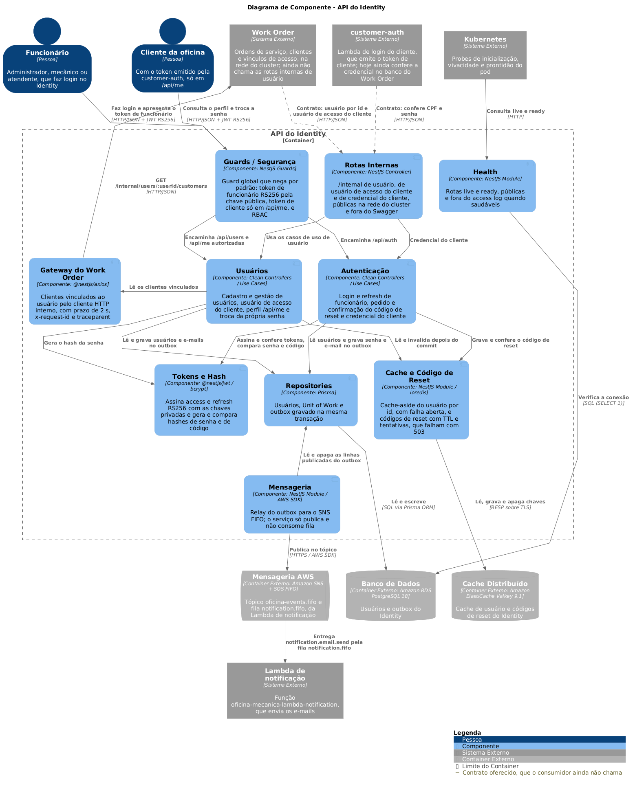

# Modelo C4: Identity Service

Nível 3 (componentes) do container NestJS do Identity Service. Os níveis 1 (contexto) e 2 (containers) da solução ficam no repositório de specs, na arquitetura da solução.

- Fonte: [`identity-component.puml`](identity-component.puml) (PlantUML, sem includes remotos).
- Imagem: [`images/c4-component.png`](images/c4-component.png), com o fonte embutido no PNG.



## Gerar a imagem

Regere o PNG sempre que o `.puml` mudar.

```bash
# A partir de docs/c4: gerar o PNG (o PlantUML grava o fonte nos metadados do PNG)
mkdir -p images
docker run --rm -i plantuml/plantuml:1.2026.6 -tpng -pipe < identity-component.puml > images/c4-component.png
```

## Elementos

### Fora do serviço

| Elemento | Tipo | Descrição |
| --- | --- | --- |
| Funcionário / outros serviços | Pessoa / Sistema | Chamam a API com o token RS256 de funcionário, pelo API Gateway |
| API Gateway / NLB | Sistema externo | O API Gateway HTTP da AWS publica `/health/identity` e `/docs/identity` e encaminha ao NLB (Network Load Balancer, o balanceador de camada 4 na frente do cluster), que entrega no NodePort 30081 (a porta fixa aberta em cada nó do Kubernetes para este serviço) |
| PostgreSQL 18 | Banco | Banco do Identity, só deste serviço; hoje guarda a tabela `outbox` |
| Valkey 9.1 | Cache | ElastiCache do Identity, só deste serviço |
| SNS FIFO `oficina-events.fifo` | Tópico | Destino do relay; um tópico para a solução |
| SQS FIFO `notification.fifo` | Fila | Fila da Lambda de notificação, assinante do tópico com filter policy por `type`; o Identity não lê dela |
| Lambda de notificação | Sistema externo | A função Lambda `oficina-mecanica-lambda-notification`, que lê `notification.fifo` e envia os e-mails do tipo `notification.email.send` |

### Componentes do Identity Service

| Componente | Responsabilidade |
| --- | --- |
| Borda HTTP | Controllers finos, Swagger em `/api/docs`, filtros de exceção, Helmet, CORS e pipes de validação |
| Guard de autenticação | `AuthenticationGuard` deny-by-default (recusa toda rota que não for marcada como pública) e `JwtStrategy` (RS256, `kid`, `iss`, `aud`, `exp`, `typ`) |
| Health | `/api/health/live` e `/api/health/ready` (prontidão confere o PostgreSQL) |
| Clean Controllers e Use Cases | Casos de uso e adaptadores de interface; ainda vazio |
| Catálogo de mensagens | Tipo publicado `notification.email.send` |
| Unit of Work e Outbox Repository | Gravam o estado e a linha do `outbox` na mesma transação (Prisma) |
| Outbox Relay | A cada 500 ms publica até 10 linhas no SNS com `MessageGroupId` = `workOrderId` ou `messageId`, sob advisory lock |
| Adaptador de cache | `ICache` com `ValkeyCacheAdapter`, cache-aside que degrada para o banco |
| Cliente HTTP interno | `InternalHttpClient` para rotas `/internal/...` de outros serviços, com `x-request-id` |
| Logging e telemetria | Logs JSON no stdout e traces e métricas pelo OpenTelemetry |

O serviço não tem consumidor de fila: só publica.

Convenção: a tecnologia ou o protocolo aparece nas setas que cruzam a fronteira do serviço.
