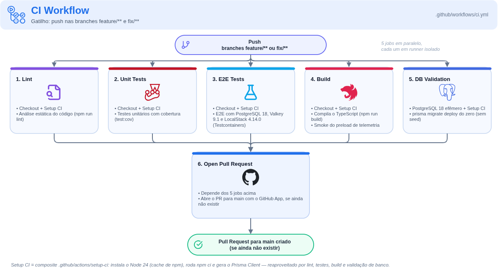
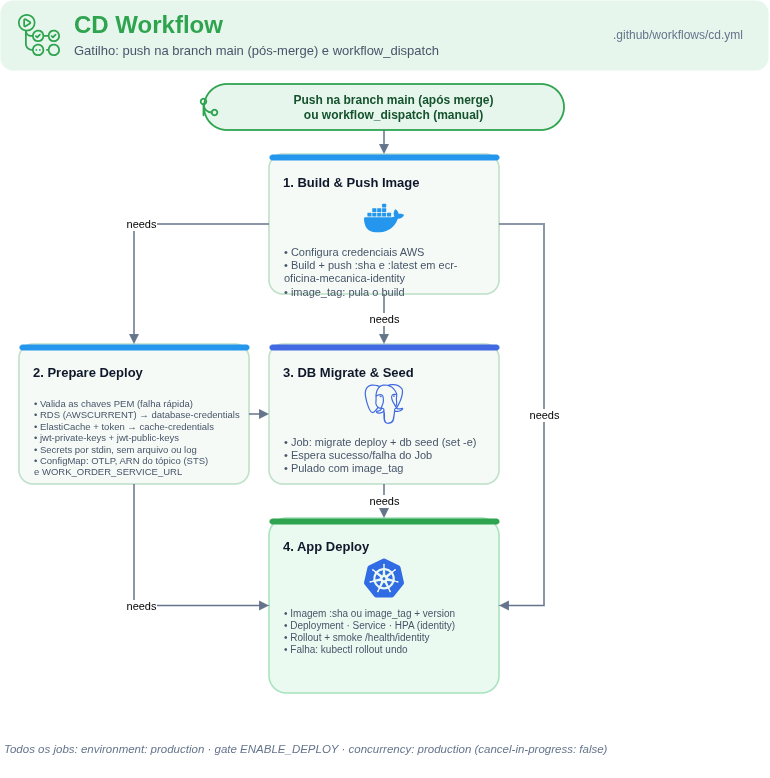
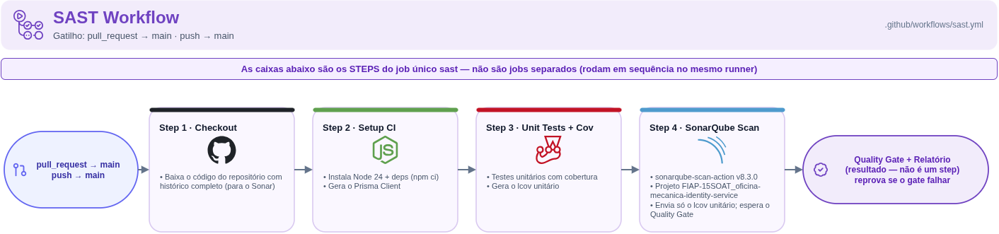
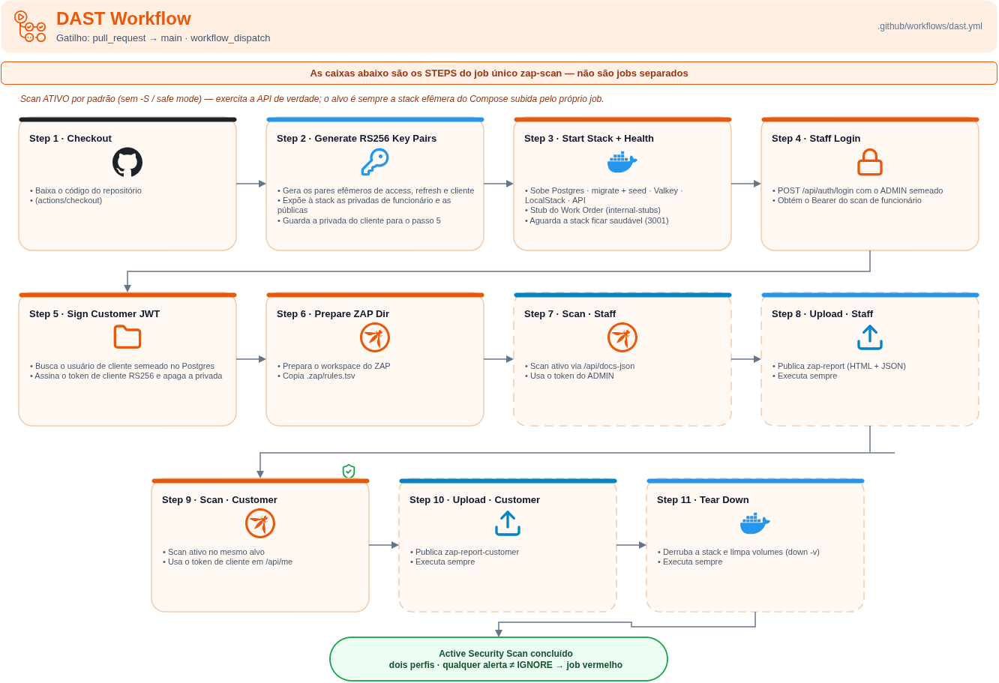

# CI/CD

Quatro workflows do GitHub Actions em `.github/workflows/`, um por responsabilidade: CI, CD, SAST (a análise estática do código, no SonarQube Cloud) e DAST (o teste dinâmico de segurança contra a API no ar, com o OWASP ZAP). Veja a [ADR 0002](adr/0002-pipelines-ci-cd-sast-dast-com-rollback.md).

> O CI dispara **só em push nas branches `feature/**` e `fix/**`**. Push em outro nome de branch não roda nenhum check de CI.

| Workflow | Gatilho | Jobs |
| --- | --- | --- |
| CI | push em `feature/**` e `fix/**` | `Lint`, `Unit Tests`, `E2E Tests`, `Build`, `DB Validation` e `Open Pull Request` |
| CD | push na `main` e `workflow_dispatch` | `Build and Push App Image`, `Prepare Deployment Configuration`, `DB Migrate & Seed` e `App Deploy` |
| SAST | pull request para a `main` e push na `main` | `SAST` |
| DAST | pull request para a `main` e `workflow_dispatch` | `OWASP ZAP API Scan` |

Os jobs que precisam do Node usam a ação composta `.github/actions/setup-ci`, que instala o Node 24 com cache do npm, roda `npm ci` e gera o Prisma Client.

## CI

`Lint`, `Unit Tests` (`npm run test:cov`), `E2E Tests` (`npm run test:e2e:cov`), `Build` (`npm run build` e o smoke, um teste rápido que confere que o preload de telemetria emite sinais) e `DB Validation` (`prisma migrate deploy` num PostgreSQL 18 descartável, sem seed) rodam em paralelo. Só quando todos passam o job `Open Pull Request` abre o PR para a `main` com o GitHub App, se ainda não houver um aberto.

## CD

1. `Build and Push App Image`: constrói a imagem e a publica em `ecr-oficina-mecanica-identity` (o repositório de imagens do Amazon ECR deste serviço) com a tag do SHA e `latest`. No `workflow_dispatch` com `image_tag`, só confere que a tag já existe no ECR (rollback manual, sem build).
2. `Prepare Deployment Configuration`: confere que as variables batem com os manifests e valida, antes de tocar no cluster, que cada chave existe e é um bloco PEM do tipo certo: `STAFF_JWT_PRIVATE_KEY` e `STAFF_JWT_REFRESH_PRIVATE_KEY` (`BEGIN PRIVATE KEY`, secrets do environment `production`), `CUSTOMER_JWT_PUBLIC_KEY` (`BEGIN PUBLIC KEY`, secret do repositório), `STAFF_JWT_PUBLIC_KEY` e `STAFF_JWT_KEY_ID` (secrets da organização); sem isso, o pod só falharia depois, em CrashLoopBackOff (o estado do pod que reinicia sem parar). Depois descobre no Amazon RDS (o PostgreSQL gerenciado da AWS) e no AWS Secrets Manager (o cofre de segredos onde o RDS guarda a senha) a credencial do banco e monta `DATABASE_URL` em `database-credentials` ([ADR 0004](adr/0004-materializacao-da-credencial-do-banco-no-cd.md)), monta `CACHE_URL` (`rediss://`) em `cache-credentials`, renderiza em base64, mascara no log e aplica por stdin os Secrets `jwt-private-keys` (as duas chaves privadas) e `jwt-public-keys` (`CUSTOMER_JWT_PUBLIC_KEY`, `STAFF_JWT_PUBLIC_KEY` e `STAFF_JWT_KEY_ID`) e aplica o ConfigMap `identity-config` (com `MESSAGING_TOPIC_ARN` renderizado com a conta da AWS e a `WORK_ORDER_SERVICE_URL` do Service do Work Order no cluster). As chaves estão em [Segurança](security.md#chaves-dos-tokens).
3. `DB Migrate & Seed`: roda o Job `db-migrate-<run>`, que executa `npx prisma migrate deploy` e depois `npx prisma db seed` num `sh -c` com `set -e` (uma migration com falha encerra o Job com falha, sem rodar o seed), e espera o resultado. O seed só cria os usuários semeados que não existem ([Banco de dados](database.md#usuários-semeados)). Pulado no rollback por `image_tag`, porque uma imagem antiga rodaria o seed dela sobre o schema novo.
4. `App Deploy`: aplica Service, HPA (o HorizontalPodAutoscaler, que ajusta o número de réplicas entre 1 e 2 pelo uso de CPU e memória) e Deployment (com a imagem de tag imutável), espera o rollout (a troca dos pods pela nova versão) e faz o smoke `GET /health/identity` pelo API Gateway (pulado com aviso se a API do gateway ainda não existe). Se o rollout ou o smoke falham, executa `kubectl rollout undo` e falha o job.

Todos os jobs rodam no environment `production`, com `concurrency: production` sem cancelar um deploy em andamento. O deploy só acontece com `vars.ENABLE_DEPLOY == 'true'` ou por `workflow_dispatch`, na `main`.

## SAST

Roda os testes unitários com cobertura e envia o lcov unitário (o relatório de cobertura no formato LCOV) ao projeto `FIAP-15SOAT_oficina-mecanica-identity-service` no SonarQube Cloud, esperando o resultado do Quality Gate, o conjunto de critérios que aprova ou reprova a análise (`sonar.qualitygate.wait=true`).

## DAST

Os passos são de um job só, `zap-scan`:

1. gera três pares RS256 efêmeros com `openssl` (access e refresh do funcionário e o do token de cliente), entrega ao serviço as duas privadas de funcionário e as duas públicas, mascara as privadas no log e apaga os arquivos delas; a privada do par de cliente fica só para o passo 4;
2. sobe o `docker-compose` do `app/` com o arquivo adicional `app/docker-compose.dast.yml`, que acrescenta o `internal-stubs`, um stub do Work Order (`.zap/internal-services-stub.mjs`) que responde `GET /internal/users/:userId/customers` com a fixture de contrato; sem ele, `GET /api/me` responderia 503 e o ZAP apontaria o erro. A migração roda com o seed;
3. faz login (`POST /api/auth/login`) com o ADMIN semeado, cujo e-mail e senha `Tech@2026` ficam no próprio workflow, porque já são públicos no seed e na collection; o access token, mascarado, é o token da primeira varredura;
4. lê no PostgreSQL do stack o id do usuário de cliente semeado `joao.silva@email.com`, assina com a privada do par de cliente um token de cliente de 60 minutos (`iss = oficina-customer-auth`, `aud = oficina-api`) e apaga a privada;
5. o OWASP ZAP 2.17 varre o contrato em `http://api:3000/api/docs-json`, pela rede do Compose, duas vezes: com o token do ADMIN (relatório `zap-report`) e com o token de cliente, que alcança `/api/me` (relatório `zap-report-customer`), as duas com as regras de `.zap/rules.tsv`.

Os relatórios HTML e JSON vão como artefatos e a stack é derrubada no fim.

## Ruleset da `main`

Os checks obrigatórios da `main` são `Lint`, `Unit Tests`, `E2E Tests`, `Build`, `SAST` e `OWASP ZAP API Scan`; `DB Validation` roda no CI, mas não é obrigatório. O merge é sempre humano, pelo PR.

## Fontes dos diagramas

Os diagramas derivam dos diagramas de CI, CD, SAST e DAST do Work Order, mantidos o layout e o estilo e adaptados ao Identity: Job de migração com seed, varreduras do DAST com o token do login e com um token de cliente efêmero, stub do Work Order no DAST, SonarQube Scan v8.3.0, namespace `identity`, `ecr-oficina-mecanica-identity` e smoke em `/health/identity`. Os PNGs em `diagrams/` carregam o XML do draw.io embutido, então são o próprio fonte: abra-os no draw.io (File > Open) para editar.
